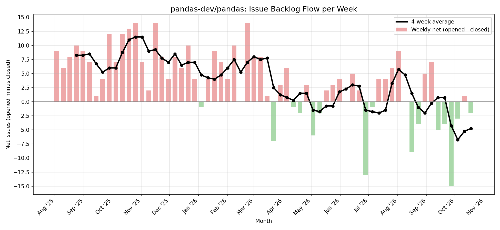
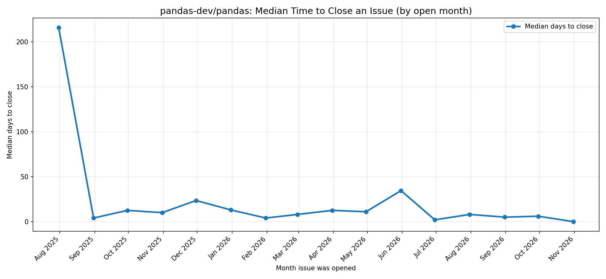

# GitHub Issues Pipeline and Dashboard

A small pipeline that pulls issues from a public GitHub repository, lands them in a local database, models them into clean layered tables, and charts two things a non technical reader can understand: whether the issue backlog is growing or shrinking, and how fast issues typically get resolved.

## What it does

The whole thing runs as one Colab notebook, top to bottom:

GitHub API  ->  raw table  ->  clean table  ->  reporting tables  ->  two charts

## Why this API

I picked the GitHub public API, reading the issues of the `pandas-dev/pandas` repository.

Reasoning: of the easy free options, GitHub is the one that naturally forces you to deal with every messy reality the assignment cares about. It paginates results, it sends live rate limit headers, it has plenty of nullable fields, and its issues endpoint quietly mixes in pull requests. So it let me show real judgement on an unreliable source instead of just reading a clean feed. I used pandas because it is large and active, so there is enough data for a real weekly trend.

## Why these metrics

**Metric 1: issues opened vs closed per week (backlog flow).**
This answers "is the project keeping up with incoming issues?" A manager reads it in seconds. I show it as net flow (opened minus closed) with a four week average, so the direction is clear instead of two tangled lines. Above zero the backlog grew that week, below zero it shrank.

**Metric 2: median days to close an issue, by the month it was opened.**
This answers the different question "how fast do issues typically get resolved?" Metric 1 is about volume, metric 2 is about speed. Together they give a fuller picture.

## Data modelling (raw, clean, reporting)

I kept three clear layers so each stage does one job and stays debuggable.

**Raw** (`raw_issues`): every API response stored exactly as it arrived, as JSON text. This is the source of truth. If a transform has a bug, I can fix it and rerun off raw without hitting the API again.

**Clean** (`clean_issues`): only the fields I need (id, state, created_at, closed_at), with dates typed properly, missing close dates kept as null, and pull requests removed.

**Reporting** (`report_weekly`, `report_monthly_ttc`): small aggregated tables, one shaped for each chart. This is the only layer the charts read from.

## Handling the realities of a live API

**Pagination:** I loop through pages until the data runs out or a page cap is hit, 100 results per page.

**Rate limits:** I read the `X-RateLimit-Remaining` header and pace calls with a short sleep. The search endpoint has a tighter limit than the core API, so the pacing matters.

**Bad responses:** any non 200 status stops the loop cleanly and prints the reason, instead of crashing.

**Missing fields:** open issues have no close date. I read that field with a safe accessor that returns null rather than erroring, and I exclude nulls when a calculation needs a close date.

**Pull requests disguised as issues:** GitHub's issues endpoint returns pull requests too, because internally a PR is a kind of issue. If left in, they inflate the counts. I switched to the search endpoint with an `is:issue` filter to exclude them at the source, and also guard against the `pull_request` field in the clean layer.

## Assumptions

- The most recent issues (roughly 1000) are a good enough sample for a trend. I capped the pull to keep runs fast and bounded.
- Weekly buckets suit the volume metric, monthly buckets suit the speed metric.
- "Resolved" means the issue has a close date.

## Tradeoffs and honest limitations

- Because the pull is newest first and capped, the timeline only reaches back as far as that sample, so the earliest weeks are not full history.
- For metric 2 I group by open month, not close month. Grouping by close month let a single very old issue closing distort a whole month and wrongly suggest a slowdown. Grouping by the month an issue was opened, plus using the median instead of the mean, removes that distortion and reflects the typical issue.
- A side effect: the most recent months in metric 2 look fast, because their slow issues have not closed yet and so are not counted. The first and last months are sample artifacts and should be read with care.
- I used Colab rather than a local setup because of limited local storage. Deployment and orchestration were out of scope, so this is a fair choice for the exercise. A real deployment would run the same code on a schedule on a server.

## Where AI helped and where I overrode it

I used an AI assistant as a mentor while building this, since I had not worked with APIs before.

Where it helped: scaffolding the pagination loop, explaining what each line does, and the three layer structure.

Where I corrected or drove the decisions myself:
- The first chart was two lines that tracked too closely to read. I rejected it and redesigned it as net flow, which is far clearer.
- The first version of metric 2 bucketed by close date and used the average. I caught that this let old issues distort the result and mislead the reader, and I changed it to group by open month and use the median.

## Setup

1. Open the notebook in Google Colab.
2. Create a GitHub personal access token (no scopes needed, it only reads public data). Settings -> Developer settings -> Personal access tokens.
3. In Colab, add the token under Secrets (the key icon) with the name `GITHUB_TOKEN`.
4. Runtime -> Restart and run all. The notebook rebuilds the database and both charts from scratch in a couple of minutes.

No paid services, no local database server. The database is a single SQLite file created at runtime.

## Files

- `github_issues_pipeline.ipynb` : the full pipeline and both charts
- `backlog_flow.png` : metric 1 chart
- `time_to_close.png` : metric 2 chart
- `README.md` : this file
